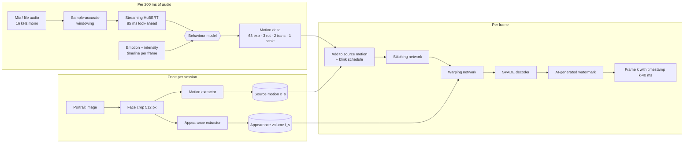
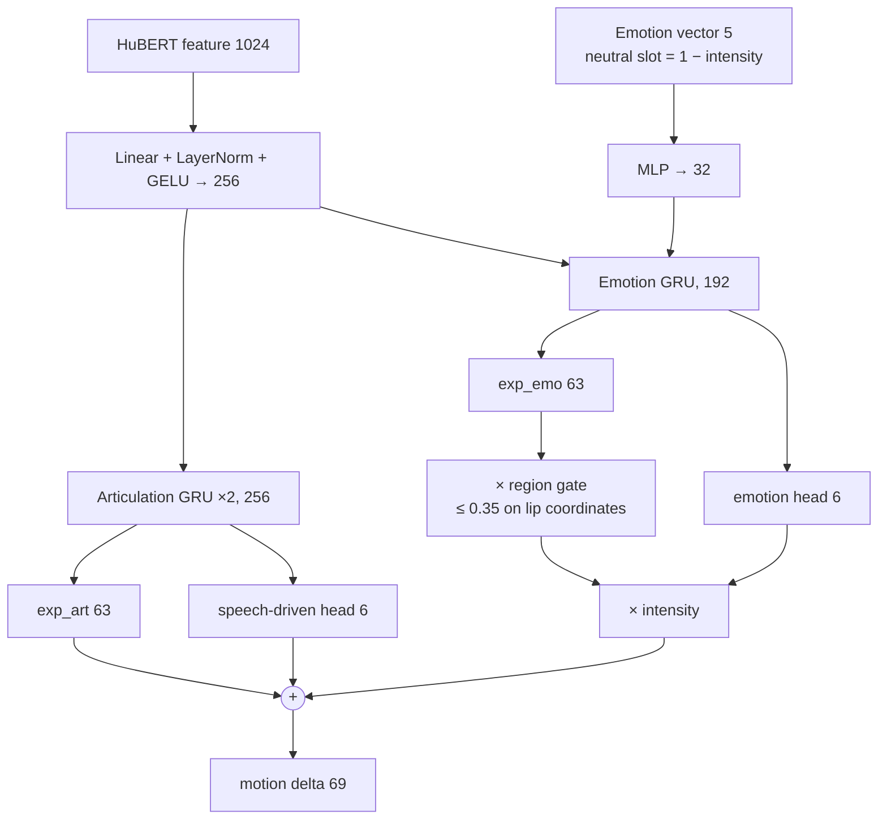

# EmoStream architecture

Status on 2026-11-14: the engine and both behaviour models run end to end on Modal GPUs. Measured numbers are in `docs/experiments/` and `docs/evaluation/`; this document describes the design and says where each part lives.

## One-paragraph summary

EmoStream separates **who the avatar is** from **what the avatar does**. A frozen pretrained renderer (LivePortrait) turns the portrait into an appearance volume once per session. A small behaviour model turns streamed speech and an emotion setting into a 69-number motion vector per video frame. The renderer warps the cached appearance with that motion and decodes one frame. Only the behaviour model is trained by us.

## Components

| Component | Source | Trained by us | Code |
|---|---|---|---|
| Face detection, landmarks, crop | InsightFace-derived ONNX models bundled with Ditto | No | `emostream/engine/runtime.py` → `Runtime.register` |
| Appearance extractor, motion extractor, warping network, SPADE decoder, stitching network | LivePortrait weights as packaged by Ditto (commit `c3e47ee`) | No (frozen) | `Runtime.render_keypoints`, `Runtime.keypoints_full_face` |
| Speech encoder | Ditto's streaming HuBERT (ONNX), 1024-d at 25 FPS | No (frozen) | `SlidingWindowChunker` + `sdk.wav2feat` |
| Baseline behaviour model | Ditto motion diffusion (LMDM), pretrained | No | `emostream/engine/behaviour.py` → `DittoBehaviour` |
| **EmoStream behaviour model** | Ours, 1.36 M parameters | **Yes**, on MEAD | `emostream/models/behaviour_net.py`, `emostream/engine/behaviour_emostream.py` |
| Emotion timeline | Ours | — | `emostream/engine/emotion.py` |
| Session, timing, telemetry | Ours | — | `emostream/engine/session.py`, `emostream/audio/clock.py`, `emostream/telemetry.py` |
| Watermark, consent gate | Ours | — | `emostream/safety.py` |

## The motion interface

The renderer defines the interface, so it is fixed and both behaviour models target it.

| Field | Size | Meaning |
|---|---|---|
| `exp` | 63 | 3-D offset of each of 21 implicit keypoints. Lips: keypoints 6, 12, 14, 17, 19, 20. Eyes: 11, 13, 15, 16, 18. |
| `pitch`, `yaw`, `roll` | 3 | Head rotation in degrees |
| `t` | 2 (of 3) | In-plane head translation |
| `scale` | 1 | Head scale |

Driving keypoints are `x_d = scale · (kp · R + exp) + t`, corrected by the stitching network, and the warping network moves the appearance volume from the source keypoints to `x_d`.

EmoStream's model predicts a **delta relative to a neutral rest pose** and the engine adds it to the uploaded portrait's own motion. Training deltas are computed against each MEAD actor's rest pose (median of the first frames of their neutral clips), so the model never learns an actor's face shape and transfers to unseen portraits.

**Full-face driving.** Ditto's stitcher keeps the generated expression only on lip and eye keypoints and copies every other keypoint from the source (`_fix_exp_for_x_d_info_v2`). That protects identity but also removes brow and cheek movement, which is where much of an emotion shows. EmoStream's path (`keypoints_full_face`) applies all 63 expression coordinates.

## Behaviour model

Design choices and the reason for each:

- **Causal GRUs, no convolutions or attention.** Chunked processing is then identical to whole-sequence processing by construction, with hidden state as the only thing carried between chunks. A unit test and an end-of-training check verify this numerically.
- **Two branches.** The articulation branch sees speech only. The emotion branch sees speech, emotion class and intensity.
- **Intensity as a multiplier.** The emotion branch's output is multiplied by the intensity, so intensity 0 and the neutral class give exactly the articulation output. Intensity is also an input, so the response need not be linear.
- **Region-aware fusion.** The emotion expression passes through a learned per-coordinate gate that is capped at 0.35 on lip coordinates. An emotion can shape the mouth but cannot replace the articulation.
- **Separated training targets.** The articulation branch is trained on targets with each clip's static emotional offset removed; the emotion branch is trained on the full target with the articulation output detached. Without this, the articulation branch would read emotion from the voice and the explicit control would have little to do. The joint alternative is kept as an ablation (`--no-separate-branches`).
- **Blinks are scheduled, not regressed.** A regression model averages blinks away. The engine adds the renderer's 15-frame blink template every 2.4–4 s (seeded), as Ditto does.

Known limitation of this first model: head motion is regressed, so it follows the mean for the given emotion and speech and is calmer than a real speaker's. A stochastic head-motion component is the planned next experiment if validation shows the motion is too still.

## Timing and latency

All timing is in samples. Frame *k* covers samples `[640k, 640(k+1))` at 16 kHz and is stamped `k × 40 ms`.

| Source of delay | EmoStream model | Ditto baseline (online) |
|---|---|---|
| Speech-encoder look-ahead | 85 ms | 85 ms |
| Encoder block (5 frames) | 0–160 ms | 0–160 ms |
| Motion-model windowing | none | a 10-frame block is emitted only after the next 10 frames arrive: +400 ms to +760 ms |
| **Algorithmic delay before compute** | **120–280 ms** | **520–880 ms** |

Compute time is added on top and is measured per stage by `StageTimer`; the latency metric is "arrival of a frame's last audio sample → frame handed to the caller", measured with audio fed at microphone pace.

## Emotion control

`EmotionTimeline` holds a piecewise-constant target (emotion, intensity) per frame. `set_emotion(..., at_seconds=…)` schedules a change at an audio position, in the same spirit as the timed emotion cues in Keyframe's SDK; without a time it starts at the end of the audio received so far. Frames already generated are never changed. The GRU state carries across the change, which smooths the transition.

## Sessions

`AvatarSession` owns one portrait and one behaviour model:

1. `require_consent` — refuses to start without portrait and audio consent.
2. `push_audio(chunk)` — any chunk size; returns the frames that became available, each with index, timestamp and measured latency.
3. `set_emotion(...)` — any time.
4. `end()` — flushes the tail so the last partial block is rendered (Ditto's own online script drops it).
5. `stats()` — frames, per-stage milliseconds, latency percentiles, GPU memory.

## What is deliberately not here

No language model, speech recognition, text-to-speech or voice cloning. No per-identity training. No Keyframe code or API.
