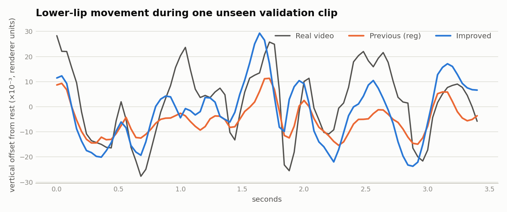

# Articulation improvement: mouth and jaw

**Result.** On unseen validation actors the avatar's mouth now opens 72–78 % as much as the real speaker's (was 40 %) and its jaw moves 78–87 % as much (was 50 %), with slightly better timing. SyncNet's lip-sync score did not change. The gap that remains is in the behaviour model's timing accuracy, not in the renderer.

## What was changed

1. **Loss.** A concordance-correlation term was added to the L1 loss (`ccc_loss` in `emostream/training/trainer.py`). For each clip and motion dimension it is `1 − 2·cov / (var_pred + var_real + (mean_pred − mean_real)²)`, which is zero only when correlation, amplitude and offset all match. Dimensions that barely move in a clip are excluded so the term cannot amplify noise. No output is multiplied by a gain.
2. **Look-ahead.** The model may see two more feature frames (80 ms) of future audio (`lookahead` in the model config; the engine waits accordingly).
3. **Rest pose.** For a portrait with an open mouth the engine closes the lips before animating, using LivePortrait's lip-retargeting network (`emostream/engine/retarget.py`).

Nothing else about the architecture changed: same two-branch causal network, 1.36 M parameters, same features, same data.

## Rendered video, 80 validation clips

Landmark-based measurements on every frame of each generated clip against the real video of the same clip (`mouth_metrics` in `modal/apps/evaluate.py`): vertical extent of the mouth, horizontal extent, and chin height, each divided by the distance between the eyes.

| | Mouth opening: correlation / amplitude | Jaw: correlation / amplitude | Mouth width: correlation / amplitude |
|---|---|---|---|
| Previous (`reg`) | 0.52 / 0.40 | 0.56 / 0.50 | 0.49 / 0.61 |
| Concordance loss (`it_ccc`), block streaming | 0.55 / 0.67 | 0.55 / 0.72 | 0.52 / 0.89 |
| + 2 frames look-ahead (`it_ccc_la2`), block streaming | **0.57 / 0.72** | **0.58 / 0.78** | 0.54 / 1.02 |
| `it_ccc_la2`, per-frame streaming (live default) | 0.55 / 0.74 | 0.57 / 0.80 | 0.54 / 1.02 |
| `it_ccc_la2`, block streaming, emotion strength 1.5 | 0.58 / 0.78 | 0.57 / 0.87 | 0.54 / 1.01 |
| Real motion through the renderer (upper bound) | 0.94 / 0.94 | 0.92 / 0.96 | 0.87 / 0.93 |

Amplitude is the ratio of standard deviations over time, summed over clips; 1.0 means as much movement as the real video.

## Motion space, all 1,589 validation clips

| | Lip correlation | Lip amplitude | Lip frame-to-frame energy |
|---|---|---|---|
| `reg` (reproduced as `it_base`) | 0.630 | 0.53 | 0.40 |
| `it_ccc` | 0.654 | 0.79 | 0.62 |
| `it_ccc_la2` | 0.666 | 0.83 | 0.63 |

## Lip-sync score

SyncNet on the 42 validation clips long enough for its pipeline:

| | LSE-C ↑ | LSE-D ↓ |
|---|---|---|
| Real video | 5.78 | 8.69 |
| Ditto | 4.75 | 9.17 |
| `reg` | 4.79 | 9.18 |
| `it_ccc_la2` | 4.76 | 9.56 |

Confidence is unchanged and the distance is slightly worse. SyncNet measures whether the mouth and the sound agree in time, and that correlation rose only from 0.52 to 0.57; it does not reward the mouth opening wider. This is reported as not improved.

## Required behaviours

| Behaviour | Status | Evidence |
|---|---|---|
| Clear mouth opening during speech | Improved | Amplitude 0.40 → 0.72–0.78 |
| Natural jaw displacement | Improved | Amplitude 0.50 → 0.78–0.87 |
| Changes in mouth width | Improved, now at real level | 0.61 → 1.0 |
| Mouth closes when speech stops | Fixed for open-mouthed portraits | Frame sheets of speech with pauses, with and without lip closing; `reg` already predicted rest during silence |
| Return to rest in pauses | Yes | Browser screenshots during pauses show closed lips |
| Bilabial closure, lip rounding, visible teeth per phoneme | **Not measured** | No phoneme-level labels were used; this needs forced alignment or human rating |
| Timing accuracy of articulation | Slightly improved, still the main gap | Correlation 0.52 → 0.57 against 0.94 achievable by the renderer |

## What was investigated

| Question from the brief | Finding |
|---|---|
| Are MEAD audio and video aligned? | Yes, within about one frame (SyncNet offsets 0 or −1 on 20 of 24 clips) |
| Are motion targets extracted correctly? | Yes: rendering them back gives 0.94 / 0.94 on mouth opening |
| Does normalisation suppress amplitude? | No |
| Does the loss pull towards the average? | **Yes — the main cause** |
| Is the representation expressive enough? | Yes: real motion in this representation reproduces the real mouth |
| Does the renderer map values correctly, and can it open the mouth? | Yes |
| Does the rendering configuration suppress articulation? | Ditto's own stitcher keeps only lip and eye coordinates; EmoStream's path uses all 63 |
| Is causal context sufficient? | Two more frames raise lip correlation by 0.012–0.021; four frames add another 0.008 for a further 80 ms of delay, which was not judged worth it |
| Do chunk boundaries cause discontinuities? | No (difference < 1e-6) |

## Streaming choice and its cost

Training features come from an encoder that produces five frames per window. Running one window per frame ("per-frame streaming") gives every frame the least look-ahead inside the encoder, which lowers accuracy:

| Model | Lip correlation, features as stored | Recomputed, block | Recomputed, per frame |
|---|---|---|---|
| `reg` | 0.596 | 0.586 | 0.539 |
| `it_ccc` | 0.674 | 0.659 | 0.603 |
| `it_ccc_la2` | 0.680 | 0.666 | 0.630 |

(24 clips of one validation actor, CPU; `evaluation/benchmarks/feature_hop_check.py`.)

Per-frame streaming is still the live default because it delivers frames evenly and 90 ms sooner (see `final_iteration_report.md`). On rendered video the look-ahead model with per-frame streaming matches the model without look-ahead under block streaming in timing (mouth correlation 0.55 for both) and has more amplitude (0.74 vs 0.67). Offline exports use block streaming. Training on per-frame features would remove the penalty; that needs the speech features recomputed and was not done.

## Remaining gap

Timing accuracy (0.57 against 0.94) is limited by what a 1.4 M-parameter causal regressor can infer from these features across unseen speakers. The renderer is not the limit. Options, none tried here: train on per-frame features; a model that predicts a distribution rather than an average (as Ditto does); speech features at their native 50 Hz; more speakers than MEAD's 33.
