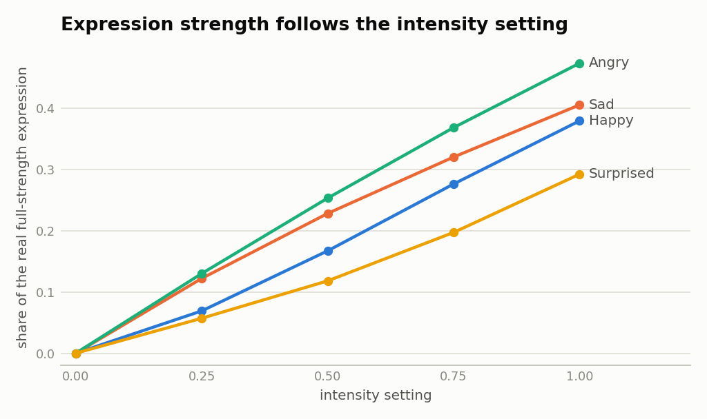

# Emotion control evaluation

**Result.** The selected emotion is an explicit control that works independently of the emotion in the voice, intensity scales the expression smoothly from exactly neutral at 0, and speech articulation is preserved under every emotion. Recognisability on rendered video rose from macro-F1 0.65 to 0.75, and to 0.81 with the emotion branch scaled by 1.5 (the new default). Real MEAD video scores 0.73 with the same classifier. Neutral is now recognised as often as in real video; it remains the hardest class.

All numbers are on the four validation actors. No human ratings were collected.

## 1. Recognisability when voice and selection agree

HSEmotion (`enet_b2_8`) on 12 frames per clip, 80 clips (16 per emotion), five classes.

| | Macro-F1 | Neutral | Happy | Sad | Angry | Surprised | ArcFace identity |
|---|---|---|---|---|---|---|---|
| Real MEAD video | 0.734 | 0.48 | 0.84 | 0.86 | 0.68 | 0.81 | 0.754 |
| Real motion through the renderer | 0.725 | 0.67 | 0.74 | 0.67 | 0.65 | 0.90 | 0.890 |
| Ditto | 0.212 | 0.12 | 0.55 | 0.23 | 0.16 | 0.00 | 0.955 |
| Previous (`reg`) | 0.651 | 0.40 | 0.58 | 0.86 | 0.65 | 0.77 | 0.930 |
| `it_ccc_la2`, strength 1.0 | 0.754 | 0.57 | 0.76 | 0.83 | 0.89 | 0.72 | 0.916 |
| `it_ccc_la2`, strength 1.5 (default) | **0.811** | 0.67 | 0.74 | 0.83 | 0.88 | 0.93 | 0.883 |

Confusion matrices (rows true, columns predicted; neutral, happy, sad, angry, surprised):

```
reg                  it_ccc_la2, 1.0       it_ccc_la2, 1.5       real video
 4 11  0  1  0        8  5  1  2  0         8  5  1  2  0         5  4  0  4  3
 0 16  0  0  0        0 16  0  0  0         0 16  0  0  0         0 16  0  0  0
 0  3 12  1  0        0  3 12  1  0         0  3 12  1  0         0  0 12  4  0
 0  6  0 10  0        0  0  0 16  0         0  1  0 15  0         0  2  0 14  0
 0  3  0  3 10        4  2  0  1  9         0  2  0  0 14         0  0  0  3 13
```

With 16 clips per class, one clip is 6 points of class recall; the same model scored 0.71–0.77 across two renderings that differed only in streaming mode, so differences below about 0.05 in macro-F1 are noise.

The 0.70 project target is met on validation by both settings. The classifier's own ceiling on this data is about 0.73, so scores above that mean "as recognisable to this classifier as the real acted clips", not "better than real".

## 2. Neutral

| | Neutral clips read as neutral | Read as happy |
|---|---|---|
| Real video | 5 of 16 | 4 |
| `reg` | 4 of 16 | **11** |
| `it_ccc_la2` | 8 of 16 | 5 |

Causes examined:

- **Classifier limitation — yes.** It labels only 5 of 16 *real* neutral speech clips neutral; visible teeth during speech pull it towards "happy".
- **Smile-like bias in the model — no.** The mean expression offset of neutral speech from rest is under half of one between-actor standard deviation on every coordinate.
- **Muted, half-open mouth in `reg` — likely.** With `reg` the mouth hovered slightly open with teeth showing; with fuller articulation and proper closures the "happy" readings fall from 11 to 5, level with real video.
- **Portrait expression — yes, separately.** A smiling or open-mouthed photo makes every emotion, including neutral, look like that photo. An open mouth is now closed automatically; a closed-lip smile in the photo is not removed.

## 3. Independence from the voice (cross-conditioning)

### Motion space, all 25 combinations

Eight clips per voice emotion per actor, four actors (`evaluation/benchmarks/emotion_control_motion.py`, model `it_ccc_la2`). Each cell is the cosine similarity between the predicted mean expression offset and the real offset of the **selected** emotion for that actor.

| Voice ↓ / Selected → | Happy | Sad | Angry | Surprised |
|---|---|---|---|---|
| Neutral | 0.43 | 0.65 | 0.74 | 0.64 |
| Happy | 0.47 | 0.66 | 0.69 | 0.68 |
| Sad | 0.46 | 0.69 | 0.69 | 0.69 |
| Angry | 0.44 | 0.69 | 0.72 | 0.68 |
| Surprised | 0.42 | 0.69 | 0.71 | 0.72 |

Each column is almost constant: the expression follows the selection, whatever the voice. The diagonal is only slightly higher than the rest.

With **neutral selected** and an emotional voice, the predicted offset is 23–26 % of the size of the real emotional offset. So some emotion from the voice does leak into a "neutral" face, at about a quarter strength.

### Rendered video

One clip per actor per voice emotion (20 clips per selected emotion, voices of all five emotions mixed), strength 1.0, classified by HSEmotion:

| Selected | Recognised as selected |
|---|---|
| Happy | 20 of 20 |
| Angry | 17 of 20 |
| Sad | 15 of 20 |
| Surprised | 11 of 20 |
| Neutral | 5 of 20 (9 read as happy) |

The four emotions hold up against a mismatched voice. Neutral scores about what real neutral clips score (5 of 16).

## 4. Intensity

Projection of the predicted expression offset on the real offset direction, as a share of the real full-strength (level 3) offset; neutral voice, eight clips per actor.

| Intensity | 0 | 0.25 | 0.5 | 0.75 | 1.0 |
|---|---|---|---|---|---|
| Happy | 0.000 | 0.069 | 0.167 | 0.276 | 0.379 |
| Sad | 0.000 | 0.122 | 0.228 | 0.320 | 0.405 |
| Angry | 0.000 | 0.130 | 0.253 | 0.368 | 0.473 |
| Surprised | 0.000 | 0.057 | 0.118 | 0.197 | 0.292 |



- At 0 the output is exactly the neutral output (this is structural: the emotion branch is multiplied by the intensity, and a unit test checks it).
- The response is monotonic and close to linear for all four emotions; there are no jumps.
- **Under-expression:** at full intensity the model reaches 29–47 % of the real level-3 strength along the real direction. A regression across 33 actors who express each emotion differently averages their directions, which shortens the result. This is why the emotion branch is scaled by 1.5 by default (`EMOSTREAM_EMOTION_GAIN`). With that scale the expression reaches roughly 45–70 %, emotion F1 rises from 0.75 to 0.81, and identity similarity stays at 0.88 (minimum 0.82). The frame sheets show stronger but undistorted expressions. Real acted level-3 expressions are still stronger.
- Intensity was verified in motion space only. Intermediate intensities were not rendered and classified.

## 5. Does emotion damage articulation?

Lip motion with an emotion selected, correlated with lip motion for the same audio rendered as neutral (motion space):

| Selected | Happy | Sad | Angry | Surprised |
|---|---|---|---|---|
| Lip correlation with the neutral rendering | 0.98 | 0.99 | 0.99 | 0.88 |

Articulation is essentially untouched for happy, sad and angry. Surprised changes lip motion more, because a surprised mouth is itself open.

On rendered video, mouth-opening correlation with the real clips is the same with emotion strength 1.0 and 1.5 (0.57 and 0.58).

## 6. Transitions

Unchanged from the previous iteration: a 10-frame cross-fade between emotion targets reduces boundary jerk by 84 % against a hard switch (motion space). Not re-measured for the new checkpoint.

## 7. Experiments that did not help

| Change | Result |
|---|---|
| Raising the cap on how much the emotion branch may move the lips (0.35 → 0.7 → 1.0) | No change in the "happy" direction (cosine 0.43–0.45) or anything else; the cap is not the limit and stays at 0.35 |
| Training the two branches jointly instead of separately | Same motion-space numbers (from the previous iteration) |

## Not done

- Human ratings of recognisability and naturalness.
- Rendered and classified intensity sweep.
- Cross-conditioning at strength 1.5 (it was run at 1.0).
- Why "happy" has the least accurate direction (0.43–0.47) while being the easiest for the classifier.
